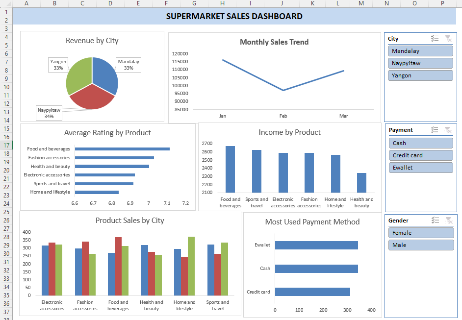

# Supermarket Sales Dashboard

## Overview
This project analyzes supermarket sales data using Microsoft Excel to create an interactive dashboard for business reporting.

## Tools Used
- Microsoft Excel
- Pivot Tables
- Pivot Charts
- Slicers
- Conditional Formatting

## Dashboard Features
- Total Revenue by City
- Sales Trend
- Product Line Performance
- Payment Method Analysis
- Average Customer Ratings
- Interactive Filters

## Skills Demonstrated
- Data Cleaning
- Data Analysis
- Dashboard Design
- Business Reporting
- Data Visualization

## Dashboard Preview

